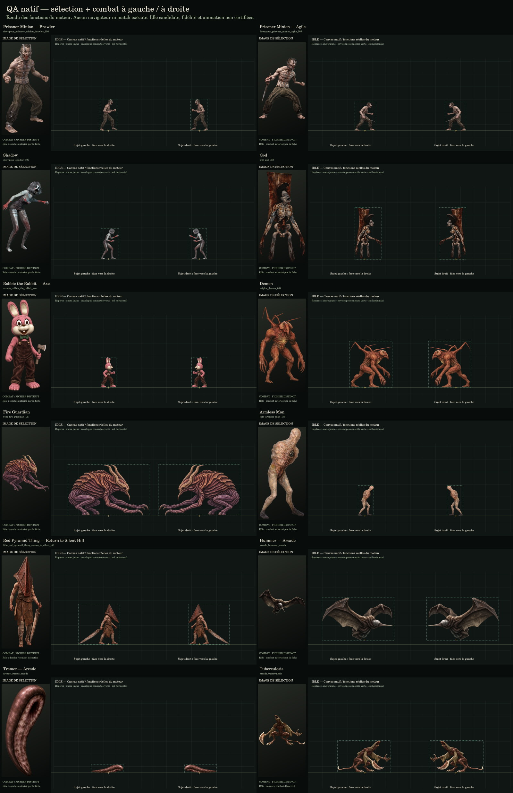

# Sélection et sprites de combat distincts — 17 novembre 2026

## Résultat

Cette suite répond à la distinction demandée entre image entière de sélection et sprite latéral dans le moteur. **15 nouveaux PNG sont intégrés : 12 poses de combat et 3 images de sélection.** Les neuf images de la passe précédente restent les sélections correspondantes, avec leurs dictionnaires et leurs octets inchangés.

| Mesure | État après cette suite |
|---|---:|
| Profils du roster | 230 |
| Images de sélection disponibles | 166 |
| Profils sans sélection ni image de combat | 64 |
| Profils avec sélection et combat distincts | 12 |
| Nouveaux combats latéraux candidats | 12 |
| Images historiques utilisables par le moteur mais non auditées comme latérales | 154 |
| Nouvelles sélections | 3 |
| Nouvelles animations complètes | 0 |
| Fidélité 1:1 certifiée | 0 |

**64 est le nombre de profils encore sans images ; ce n’est pas le nombre total de sprites latéraux restant à contrôler.** Les 154 profils historiques sont inchangés et ne sont pas automatiquement déclarés conformes à la nouvelle demande de vue de côté.

## Livraisons par profil

Chaque ligne ci-dessous possède deux fichiers différents : un portrait de sélection et une nouvelle pose idle orientée à droite. Le miroir de présentation permet de faire face à l’adversaire depuis l’autre côté. Il ne constitue pas une deuxième vue anatomique indépendante.

| Profil | ID exact | Sélection | Combat : dimensions natives | Rôle conservé |
|---|---|---|---|---|
| Prisoner Minion — Brawler | `downpour_prisoner_minion_brawler_108` | Conservée | 941 × 1672 | Rôle de combat actif |
| Prisoner Minion — Agile | `downpour_prisoner_minion_agile_109` | Conservée | 941 × 1672 | Rôle de combat actif |
| Shadow | `downpour_shadow_107` | Conservée | 941 × 1672 | Rôle de combat actif |
| God | `sh3_god_050` | Conservée | 941 × 1672 | Rôle de combat actif |
| Demon | `origins_demon_084` | Conservée | 1536 × 1024 | Rôle de combat actif |
| Fire Guardian | `bom_fire_guardian_137` | Conservée | 1672 × 941 | Rôle de combat actif |
| Armless Man | `film_armless_man_170` | Conservée | 941 × 1672 | Rôle de combat actif |
| Red Pyramid Thing — Return to Silent Hill | `film_red_pyramid_thing_return_to_silent_hill` | Conservée | 1671 × 941 | Dossier, combat désactivé |
| Robbie the Rabbit — Axe | `arcade_robbie_the_rabbit_axe` | Conservée | 941 × 1672 | Rôle de combat actif |
| Hummer — Arcade | `arcade_hummer_arcade` | Nouvelle | 1774 × 887 | Rôle de combat actif |
| Tremer — Arcade | `arcade_tremer_arcade` | Nouvelle | 2172 × 724 | Rôle de combat actif |
| Tuberculosis | `arcade_tuberculosis` | Nouvelle | 1536 × 1024 | Dossier, combat désactivé |

Les chemins des deux fichiers, SHA-256, calibrations et notes de chaque livraison sont dans [le journal de génération](combat-generation-2026-11-17.json). **Tuberculosis et Red Pyramid Thing — Return to Silent Hill conservent leur combat désactivé** dans la politique du projet : les images de ces dossiers n’activent pas un nouveau rôle. Les dix autres profils possèdent déjà un rôle de combat actif.

## Intégration au moteur

La sélection utilise le descripteur `portrait`. Le rendu, le préchargement, les réservations mémoire et le cadrage du combat utilisent uniquement les frames de combat admissibles. Un profil marqué `selection-only` ne peut plus utiliser son portrait comme pose de combat, même en présence d’un ancien idle résiduel. Les profils historiques restent compatibles et portent un état de vue non auditée.

L’atelier affiche séparément l’image de sélection et l’aperçu combat, avec leurs liens et les filtres de suivi. Les compteurs distinguent sélection disponible, combat latéral candidat, vue historique à contrôler et combat absent. Le filtre de sélection du versus et le choix aléatoire vérifient aussi la disponibilité du combat.

L’importeur propose `--selection`, `--selection-only` et `--combat-idle`, avec préservation de l’autre usage et provenance séparée. Il refuse de remplacer accidentellement plusieurs poses existantes ou de réutiliser les mêmes pixels comme nouvelle vue distincte.

Les anciens relevés ART144/ART92 ne sont pas réécrits. Les journaux ultérieurs sont raccordés par ID et fichier exacts ; une sélection seule ne résout pas un besoin de combat. Une livraison candidate ne certifie ni fidélité, ni animation, ni approbation.

## Références et limites visuelles

Les neuf premières poses reprennent les références déjà consignées dans [la provenance de la passe précédente](../../art/provenance-20261117.json), complétées par leur sélection conservée. Hummer, Tremer et Tuberculosis s’appuient sur les captures de **The Arcade**, publiées dans [le parcours du jeu par DivulganteMorte](https://www.divulgantemorte.com/2023/09/analisemorte-silent-hill-arcade-tudo.html). Les URL des fichiers, hashes et limites sont dans [le rapport de références Arcade](combat-references-arcade-2026-11-17.json). Les captures sont des WEBP natifs de 639 × 476 px malgré l’extension locale `.jpg` ; aucune texture fine native n’est déduite comme certitude de cette faible résolution.

Tous les nouveaux combats sont des **idle statiques candidats**. Les dimensions natives sont mesurées dans le tableau ; aucune sortie n’est annoncée comme UHD/4K native. La fidélité demeure `unverified`. Aucune marche, attaque, garde animée, réaction ou finisher supplémentaire n’est créée par cette passe.

Les réserves sont enregistrées individuellement : Brawler conserve environ 48 px d’écart entre ses appuis ; Tuberculosis environ 24 px, avec une courbure de queue adaptée. God garde un trois quarts latéral et ses extrémités inférieures canoniques sans pieds ajoutés. La stature de God exclut le rideau, celle de Demon les projections dorsales ; Fire Guardian, Hummer et Tremer utilisent des conventions adaptées à leurs morphologies. La première sortie de Pyramid Return était trop proche des bords ; seule sa correction aux marges de 108 px en haut et 132 px en bas est importée.

La référence de Pyramid Return demeure une figurine licenciée de cette édition ; Armless repose sur le costume du film 2006. Leur concordance exacte avec les effets et apparences finaux à l’écran n’est pas certifiée. Robbie conserve les incertitudes documentées sur la dentition et la géométrie exacte de sa hache. Le détail de toutes les revues est dans [le rapport d’import](combat-integration-qa-2026-11-17.json).

## Vérification visuelle

Les **12 profils ont été rendus dans les deux orientations** avec `drawRasterMonster`, `paintRasterPortrait` et `combatFraming`, au moyen du Canvas 2D natif déjà installé. Toutes les enveloppes de combat sont contenues dans le cadrage et tous les placements miroir sont cohérents. Les faibles écarts de pixels dus au rééchantillonnage sont consignés ; l’identité bit à bit du miroir n’est pas revendiquée.

Il s’agit d’une vérification des fonctions de rendu du moteur, **sans navigateur ni match exécuté**. Elle ne valide pas les interactions DOM, le service worker, une partie jouée ou les animations. Le lancement Chromium était bloqué par la restriction système `socket() failed: Operation not permitted` lors de la passe précédente ; le navigateur distant ne pouvait pas joindre le serveur local. Ces tentatives bloquées n’ont pas été répétées. [Rapport du rendu natif](combat-native-render-2026-11-17.json).

## Validation technique

VALIDATION_PENDING

## Profils encore manquants

Les 67 profils de la passe précédente deviennent **64** après l’ajout de Hummer, Tremer et Tuberculosis. Numb Body — Arcade dispose maintenant de références candidates, mais sa génération de sélection a été refusée par l’outil au stade de sortie ; aucun nouvel essai ni combat de substitution n’a été demandé.

| Motif principal des 64 restants | Nombre |
|---|---:|
| Source incomplète | 26 |
| Identité ou variante incertaine | 7 |
| Forme immatérielle | 2 |
| Refus ou arrêts historiques | 26 |
| Refus récents : 2 de la passe précédente, 1 de cette suite | 3 |
| **Total** | **64** |

La [liste exacte des 64 profils](COMBAT_REMAINING_2026-11-17.md) conserve l’historique. Les recherches supplémentaires sur Book of Memories et Ascension, portant sur huit profils, n’ont pas fourni de nouveau corps complet attribuable : [rapport de références complémentaires](combat-references-extended-2026-11-17.json).

## Livraison

Cette suite complète la PR en brouillon [#6](https://github.com/darknigthmare/silent-hill-halo-of-flesh/pull/6), sur `art/missing-fullbody-20261117`. La version reste **0.9.6**, les IDs et règles de gameplay sont conservés. La prévisualisation Vercel de la passe précédente a échoué sur son quota journalier ; aucune prévisualisation jouable réussie n’est revendiquée.
