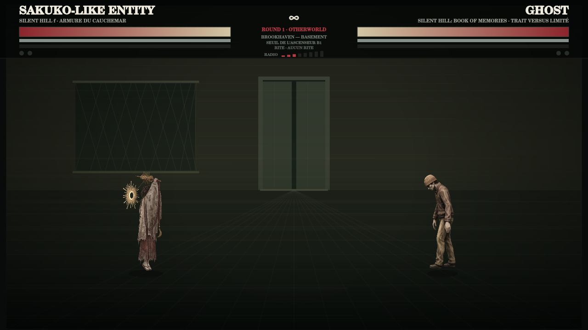

# Nouveaux sprites de sélection et de combat

Le jeu dispose de **184 fiches illustrées sur 230**. Ce lot ajoute 3 premières illustrations et 12 poses de combat latérales. Il reste 46 fiches sans image.

| Personnage | Édition | Sélection | Combat |
| --- | --- | --- | --- |
| Ghost | SILENT HILL: BOOK OF MEMORIES | [1024 × 1536 PNG](../../assets/sprites/bom_ghost_125.6fa510a96dba.png) | [1024 × 1536 PNG](../../assets/sprites/bom_ghost_125.ed274487b37b.png) |
| Joseph Schreiber — Victim 15 | SILENT HILL 4: THE ROOM | [1277 × 1231 PNG](../../assets/sprites/sh4_joseph_schreiber_victim_15.41c23490fcf2.png) | Sélection seule |
| Sakuko-Like Entity | SILENT HILL f | [1132 × 1390 PNG](../../assets/sprites/shf_sakuko_like_entity_162.f15d4f66c8da.png) | [992 × 1586 PNG](../../assets/sprites/shf_sakuko_like_entity_162.f4949f7cbcc6.png) |
| Puppet Doctor | SILENT HILL | Portrait antérieur | [1161 × 1355 PNG](../../assets/sprites/sh1_puppet_doctor_013.7ac753d023c5.png) |
| Creeper | SILENT HILL | Portrait antérieur | [2172 × 724 PNG](../../assets/sprites/sh1_creeper_009.57fcc90186ee.png) |
| Gum Head — Old Type | SILENT HILL 4: THE ROOM | Portrait antérieur | [1453 × 1082 PNG](../../assets/sprites/sh4_gum_head_old_type_057.e75cbbab2b25.png) |
| Smog | SILENT HILL: HOMECOMING | Portrait antérieur | [1199 × 1312 PNG](../../assets/sprites/homecoming_smog_087.63ce313a3705.png) |
| Split Worm | SILENT HILL 3 | Portrait antérieur | [2172 × 724 PNG](../../assets/sprites/sh3_split_worm_046.5e27e5f4f9bf.png) |
| Lying Figure | SILENT HILL 2 | Portrait antérieur | [1536 × 1024 PNG](../../assets/sprites/sh2_lying_figure_020.af82da95d655.png) |
| Gum Head — New Type | SILENT HILL 4: THE ROOM | Portrait antérieur | [1217 × 1293 PNG](../../assets/sprites/sh4_gum_head_new_type_058.a0cf8e0bcf4e.png) |
| Lurker | SILENT HILL: HOMECOMING | Portrait antérieur | [1774 × 887 PNG](../../assets/sprites/homecoming_lurker_085.f75a3e452a0b.png) |
| Straight-Jacket | SILENT HILL: ORIGINS | Portrait antérieur | [1024 × 1536 PNG](../../assets/sprites/origins_straight_jacket_074.44bc2de11b55.png) |
| Caliban | SILENT HILL: ORIGINS | Portrait antérieur | [1774 × 887 PNG](../../assets/sprites/origins_caliban_079.f7c29928e5e8.png) |

## Trois premières illustrations

**Ghost, Book of Memories.** La capture PS Vita de Blood World identifie le Dark Ghost et montre ses deux chaussures en suspension. Une icône du bestiaire complète sa tête et son vêtement. Le compteur du jeu chevauche une cheville. Les deux images du projet utilisent cette même apparence, avec une pose latérale distincte pour le combat. [Sources du Ghost](wave5-references/bom-ghost/source-audit.json)

**Joseph Schreiber, Silent Hill 4.** La scène dans Apartment World montre sa tête à l’envers et ses épaules absorbées par le plafond. Le portrait s’arrête à leur jonction visible avec la pièce. Il conserve son rôle non combattant. [Vues du jeu](wave5-references/joseph-grady/research.json)

**Entité ressemblant à Sakuko, Silent Hill f.** Une séquence sur PS5 montre la figure en suspension avec une lueur devant le visage, un instrument, une chaîne et des sandales. La fiche conserve le nom prudent du journal du jeu ainsi que son rôle de combattant. Le profil, tourné à gauche dans son fichier natif, reprend le halo décalé derrière la tête et l’instrument relevé de la phase lumineuse. L’épaisseur des rayons et l’attache apparente du halo restent interprétées. [Références de la rencontre](wave5-references/sakuko/source-audit.json)

## Vues de combat

Les deux Gum Heads de Silent Hill 4 gardent leur morphologie respective. Le Old Type s’appuie sur une main et le New Type conserve son tuyau métallique courbé. Le combat du Puppet Doctor utilise une posture aux deux pieds plantés et au scalpel bas. L’image de Split Worm reprend la forme extérieure exposée dans le rendu de Silent Hill 3. La partie accessible en dehors du tunnel délimite ce sprite.

Les [prompts, références et décisions](sprite-wave5-generation-2026-11-18.json) permettent de retrouver chaque sortie et les poses écartées lors de la revue visuelle. Le jeu applique le miroir horizontal pour l’autre côté de l’arène.

## Vérification dans le jeu

Les contrôles avec le moteur Canvas ont vérifié 233 assertions, 12 duels et 26 rendus de portraits. Le jeu conserve 267 anciens PNG octet pour octet et les 181 portraits déjà affectés. Les 15 nouveaux fichiers correspondent aux empreintes du [journal d’import](sprite-wave5-imports-2026-11-18.json).

Le test complet a réussi avec 1259 tests et zéro échec. [Journal des tests](qa-sprite-wave5-2026-11-18/npm-test.log.gz) · [Captures et contrôles visuels](qa-sprite-wave5-2026-11-18/)

Le catalogue totalise 282 PNG, 59 vues latérales de combat et 119 vues de combat historiques à examiner. Les nouveaux sprites sont des poses fixes. Aucune de ces reconstitutions n’est certifiée 1:1. [Inventaire des 46 fiches encore sans image](sprite-status-wave5-2026-11-18.json)

Les 111 tests Python de la chaîne graphique ont réussi. [Journal Python](qa-sprite-wave5-2026-11-18/python-art-tests.log.gz)

Les 7 contrôles de préparation préservent les rôles de Joseph, Ghost et de l’entité ressemblant à Sakuko. [Vérification des rôles](qa-sprite-wave5-2026-11-18/role-check.json)

Chromium 153.0.8010.0 a passé 310 contrôles ciblés sur le build, dont la sélection, les combats, le mode hors ligne et la sauvegarde. [Rapport Chromium](qa-sprite-wave5-2026-11-18/browser-sprites.json)

La suite HTTP ART92 a passé 413 contrôles sous Chromium. Elle vérifie séparément le portrait historique du Split Worm et le nouveau sprite montré en combat. [Rapport ART92](qa-sprite-wave5-2026-11-18/art92-browser.json.gz)

## Fiches encore à illustrer

Le relevé distingue les nouvelles recherches des blocages hérités. La capture indépendante de la borne remet en question l’arme attribuée à Robbie. Le nom du modèle publié est Robbie_Rifle. Les attaches du Wheelman géant restent masquées dans les vues d’Overlook. La vue isolée retrouvée représente sa petite apparition en fauteuil. [Audit Arcade et Ascension](wave5-references/arcade-ascension/source-audit.json) · [Comparaison du Wheelman](wave5-references/downpour/sources.json)
