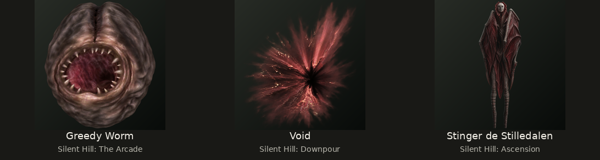
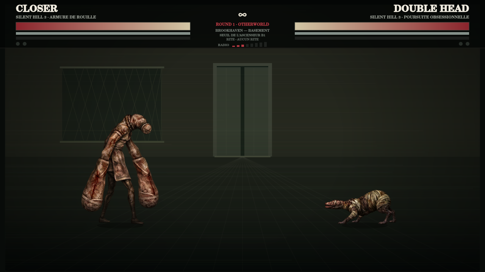

# Sprites de sélection et vues de profil

Le catalogue compte **187 fiches illustrées sur 230**. Il reste **43 fiches sans image**. Ce lot apporte 3 premières illustrations, 8 poses pour des combattants jouables et 3 vues de profil réservées à l’atelier.

## Fiches illustrées pour la première fois

| Personnage | Œuvre | Illustration de sélection |
| --- | --- | --- |
| Greedy Worm | The Arcade | [PNG 1261 × 1247](../../assets/sprites/arcade_greedy_worm_arcade_119.9ce02fc3c41e.png) |
| Void | Downpour | [PNG 1254 × 1254](../../assets/sprites/downpour_void_113.aaad63ad6961.png) |
| Stinger de la scène de Stilledalen | Ascension | [PNG 978 × 1609](../../assets/sprites/ascension_stilledalen_stinger_184.214630045589.png) |

Dans la prison de Toluca, le Greedy Worm apparaît dans l’axe du couloir, son corps se prolongeant derrière sa bouche. La capture de trois quarts ne donne qu’une section du flanc. Le jeu présente donc le portrait frontal. [Séquence de la borne](wave6-references/arcade/research.json)

Le Void reprend le foyer noir et les rayons rouge foncé de la poursuite dans le restaurant. L’étendue du halo correspond au cadrage de cette phase. Son rôle reste celui d’un danger environnemental. [Vues de Downpour](wave6-references/downpour/void-source-audit.json)

Dans *Breadcrumbs*, Astrid et Karl voient le Stinger encore replié à 52 secondes. Il ouvre ses ailes à 54 secondes. Les gros plans de *Aasta* documentent la matière des ailes. La fiche représente cette apparition norvégienne. L’existence d’une espèce régionale autonome reste indéterminée. [Captures de Genvid](wave6-references/stinger/source-audit.json)

## Vues latérales

| Personnage | Œuvre | Usage dans le jeu | Fichier |
| --- | --- | --- | --- |
| Creeper | Silent Hill 2 (2001) | Duel | [PNG 2172 × 724](../../assets/sprites/sh2_creeper_025.f562380701ab.png) |
| Ariel | Silent Hill: Origins | Duel | [PNG 1024 × 1536](../../assets/sprites/origins_ariel_078.e3ffa353215f.png) |
| Mumbler | Silent Hill (1999) | Duel | [PNG 1199 × 1312](../../assets/sprites/sh1_mumbler_006.5f63afd9befb.png) |
| Tremer — Blue | Silent Hill 4: The Room | Atelier seul | [PNG 2172 × 724](../../assets/sprites/sh4_tremer_blue_063.0a6c15a7fc9a.png) |
| Jimmy Stone — Victim 1 | Silent Hill 4: The Room | Duel | [PNG 1024 × 1536](../../assets/sprites/sh4_jimmy_stone_victim_1.bf7771716749.png) |
| Lying Figure — Crawling | Silent Hill 2 (2001) | Duel | [PNG 2172 × 724](../../assets/sprites/sh2_lying_figure_crawling_021.2a35fe388a6b.png) |
| Tremer — Red | Silent Hill 4: The Room | Atelier seul | [PNG 2172 × 724](../../assets/sprites/sh4_tremer_red_064.50aee55d75d4.png) |
| Bogeyman | Homecoming | Atelier seul | [PNG 1536 × 1024](../../assets/sprites/homecoming_bogeyman_092.fe3495981694.png) |
| Order Soldier | Homecoming | Duel | [PNG 1199 × 1312](../../assets/sprites/homecoming_order_soldier_091.2230de7fb2f9.png) |
| Closer | Silent Hill 3 | Duel | [PNG 1143 × 1376](../../assets/sprites/sh3_closer_036.19e033cd6a51.png) |
| Double Head | Silent Hill 3 | Duel | [PNG 1774 × 887](../../assets/sprites/sh3_double_head_040.8c3f9985c31e.png) |

Le Mumbler garde les deux pieds au sol et Ariel prend appui sur ses mains. Le soldat de l’Ordre s’accroupit et ramène le tuyau contre lui. Sa première proposition, trop proche du portrait, a été écartée. La Doll de *Downpour* garde son portrait antérieur. La génération de sa vue latérale n’a livré aucun fichier. [Prompts et décisions](sprite-wave6-generation-2026-11-18.json)

Le Closer et le Double Head ont chacun un nouveau repos de combat. Leurs images de marche, de réaction au coup et de KO conservent leurs fichiers et leurs séquences.

## Contrôles dans le jeu

251 contrôles visuels et de rôle ont réussi, dont 8 duels et 22 rendus de sélection. Le contrôle des fichiers a confirmé la conservation des 282 PNG antérieurs et des 184 portraits précédents. [Mesures et captures](qa-sprite-wave6-2026-11-18/)

Le projet a passé 1261 tests JavaScript, 114 tests de la chaîne graphique et 324 contrôles du build dans Chromium. [Journal du jeu](qa-sprite-wave6-2026-11-18/npm-test.log.gz) · [Journal de la chaîne graphique](qa-sprite-wave6-2026-11-18/python-art-tests.log.gz) · [Contrôle navigateur](qa-sprite-wave6-2026-11-18/browser-sprites.json)

Chromium a validé 1004 contrôles de la campagne ART144. [Rapport](qa-sprite-wave6-2026-11-18/art144-browser.json.gz)

Chromium a validé 410 contrôles de la campagne ART92. [Rapport](qa-sprite-wave6-2026-11-18/art92-browser.json.gz)

Dans l’atelier, le cadrage dépend du zoom manuel. La pointe de la lame du Bogeyman dépasse le cadre d’environ 16 pixels à 150 %. Au zoom par défaut de 100 %, la lame entière est visible.

Les fichiers sont des poses fixes à leur résolution native. Le catalogue réunit 296 PNG et 70 vues latérales dédiées, rôles jouables et documentaires compris. La fidélité 1:1 reste à valider. [Inventaire des 43 fiches restantes](sprite-status-wave6-2026-11-18.json)
