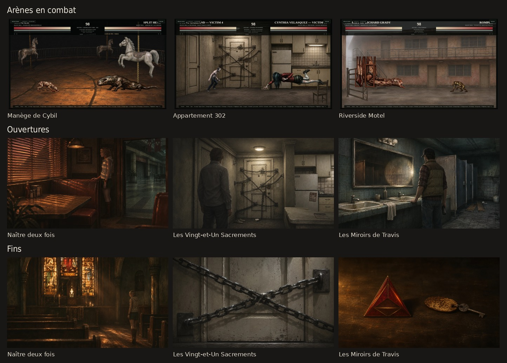

# Sprites, arènes et illustrations des chroniques

Cette vague ajoute 22 images au jeu. Sad Daddy, manifestation de Richard Grady dans la chambre 500, a désormais son portrait de sélection et sa posture fixe de combat. Les six adversaires des *Miroirs de Travis* disposent ainsi d’une image de duel pour le lancement normal de la chronique.

## Personnages

| Épisode | Nouvelles poses de profil en duel |
| --- | --- |
| Silent Hill | Groaner, Wormhead, Split Head et Romper |
| Silent Hill 3 | Slurper |
| Silent Hill 4 | Hummer, Steve Garland (victime 04) et Cynthia Velasquez (victime 16) |
| Silent Hill: Origins | Sad Daddy, également ajouté à la sélection |

Le modèle à deux angles publié par Konami délimite l’installation suspendue de la chambre 500. La sélection présente la cage de trois quarts. En combat, les panneaux se superposent en vue de profil et le cou se déploie horizontalement. Le boss garde son ancrage et ses règles d’origine dans le jeu. [Sources de la chambre 500](wave7-references/sad-daddy.json)

Les neuf nouvelles poses sont statiques. Six personnages conservent chacun trois images de mouvement antérieures. Les 296 anciens PNG et les 187 portraits précédents ont été comparés octet par octet ou par leur empreinte Git. Une proposition supplémentaire pour Insane Cancer a été écartée à l’intégration, sa fiche disposant déjà d’une pose latérale. [Fichiers et sources](sprite-wave7-imports-2026-11-18.json) · [Prompts et résultats](sprite-wave7-generation-2026-11-18.json)

## Arènes

| Lieu | Décor de fond et premier plan mobile |
| --- | --- |
| Lakeside Amusement Park, Silent Hill | La plateforme du manège et un cheval sur son mât |
| Appartement 302, Silent Hill 4 | La porte enchaînée et la kitchenette, avec une chaise au bord droit |
| Riverside Motel, Silent Hill: Origins | La cour et son escalier métallique, avec le portillon ajouré au bord gauche |

Le jeu déplace le premier plan par rapport au fond quand les combattants traversent l’arène. Les préférences de mouvement réduit stabilisent le décor. Le contrôle Chromium mesure respectivement 97,2 px, 69,12 px et 48,6 px de déplacement différentiel sur le même balayage à 1280 × 720. [Trois captures animées en combat](wave7-stages/README.md)

## Mode histoire

| Chronique | Ouverture | Fin |
| --- | --- | --- |
| Naître deux fois | Heather au seuil du diner et de la galerie marchande | Heather devant les vitraux de la chapelle |
| Les Vingt-et-Un Sacrements | Henry devant la porte condamnée du 302 | Gros plan sur les chaînes de la porte |
| Les Miroirs de Travis | Travis face au miroir | Le Flauros assemblé et la clé de la chambre 500 |

Les ouvertures apparaissent dans les Archives et à la première rencontre. Les fins accompagnent le bilan après la dernière victoire. Les images suivent l’écriture des chroniques de *Halo of Flesh*. [Illustrations et références](wave7-story/README.md)

## Couverture après intégration

| Élément | État |
| --- | --- |
| Personnages | 188 portraits sur 230, 42 fiches sans portrait |
| Combat | 79 vues latérales, 100 anciennes vues à revoir, 51 fiches sans sprite de combat |
| Décors | 9 lieux avec des décors bitmap sur 123, dont 7 correspondant à la pièce actuellement jouée |
| Histoire | 3 chroniques avec ouverture et fin sur 15, 12 paires à illustrer |

Le registre distingue les 114 lieux sans aucun décor bitmap des deux lieux dont l’image historique correspond à une autre pièce. Les positions de caméra, les poses et les visuels de cette vague restent des adaptations graphiques. [Inventaire des lieux et des chroniques à poursuivre](wave7-stages/backlog.md) · [État des personnages](sprite-status-wave7-2026-11-18.json)

## Vérification dans le jeu

Le moteur natif a effectué 244 contrôles des sprites sur dix duels et dix-huit rendus de sélection. Il a notamment contrôlé le cadrage des deux joueurs et les fichiers réellement dessinés. Sur le build distribué, Chromium a lancé les dix duels depuis la sélection normale, dans les deux ordres, et identifié les nouveaux sprites à l’écran. [Rendus du moteur](qa-sprite-wave7-2026-11-18/engine/report.json) · [Duels du build](qa-sprite-wave7-2026-11-18/versus/report.json)

Les trois chroniques ont atteint leur bilan par les boutons du jeu. La vérification a accéléré les KO pour parcourir les dix-sept rencontres, puis testé la défaite, la reprise et la consultation hors ligne des quinze dossiers. Les six illustrations ont gardé leur empreinte après coupure réseau. Le rapport réunit les 121 contrôles et les neuf captures des parcours. [Chroniques du build](wave7-story/qa/report.json) · [Mesures de la parallaxe en combat](wave7-stages/captures/report.json)

Le build a réussi les 1262 tests JavaScript et les 114 tests de la chaîne graphique. Les suites Chromium existantes ont également réussi leurs 334 contrôles de sprites et du cache hors ligne, leurs 17 contrôles des décors et leurs 27 contrôles des chroniques. [Tests du jeu](qa-sprite-wave7-2026-11-18/tests-jeu.log.gz) · [Tests graphiques](qa-sprite-wave7-2026-11-18/tests-graphismes.log.gz) · [Contrôles du navigateur](qa-sprite-wave7-2026-11-18/browser-sprites.json.gz)
