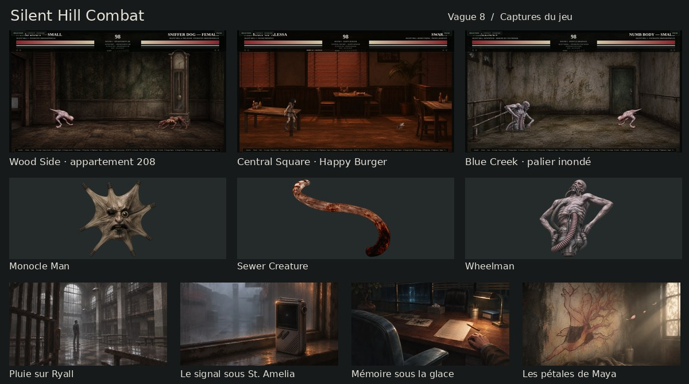

# Silent Hill Combat — personnages, arènes et chroniques de la vague 8

La forme géante du Wheelman d’Overlook dispose de son premier portrait et d’une pose de combat de profil. Dans *Pluie sur Ryall*, Anne peut désormais l’affronter au quatrième des cinq combats de la chronique. Après le cinquième combat, le jeu affiche le bilan et la nouvelle illustration du choix entre Anne et Murphy.

## Personnages

| Usage | Nouveaux visuels |
| --- | --- |
| Sélection | Wheelman d’Overlook, Monocle Man du train de Devil’s Pit, Sewer Creature des égouts de SH3 |
| Garde de profil en duel | Wheelman, petit Numb Body, Memory of Alessa au couteau, Sniffer Dog femelle, Eric Walsh, Sharon Blake et un spécimen du Swarm |
| Déplacement | Air Screamer en vol horizontal. Dès que le déplacement cesse, son cycle de repos à trois images reprend. |
| Atelier | Fauteuil roulant vide de *Silent Hill 4* en profil gauche |

Pour le Wheelman, les captures du combat du guide officiel Prima délimitent le buste raccordé aux tuyaux de maintien. La pose latérale reconstitue la partie visible de cette installation. Pour le Monocle Man, le portrait s’arrête aux brides autour de la tête qui apparaît dans le train. Pour la Sewer Creature, il représente un tentacule entier du modèle visible sous la grille. Ces deux rencontres restent consultables en dossier. L’échelle du Wheelman suit le cadrage du moteur de combat. La fidélité exacte des reconstitutions et une résolution native UHD restent à établir. [Sources du Wheelman](wave8-references/wheelman.json) · [Monocle Man](wave8-references/mono.json) · [Sewer Creature](wave8-references/sewer.json)

Les huit poses de garde ou d’atelier sont statiques. Les poses au pistolet et au tuyau de Memory of Alessa, les trois autres images du petit Numb Body et les trois de la Sniffer Dog femelle conservent leur contenu. Le registre couvre 191 portraits sur 230 et 87 profils ayant une pose latérale distincte. Il reste 39 portraits à produire, 50 profils sans image de combat et 93 profils dont la vue de combat ancienne reste à vérifier. Ces totaux incluent les dossiers. Les 306 anciens PNG et les 188 portraits historiques ont été contrôlés. [Inventaire des manquants](sprite-status-wave8-2026-11-18.json) · [Imports](sprite-wave8-imports-2026-11-18.json) · [Vol de l’Air Screamer](wave8-air-screamer.json)

## Arènes

Les trois lieux utilisent deux PNG indépendants. Le premier plan bouge avec la position des combattants. À 1 280 × 720, le déplacement mesuré entre les deux extrémités atteint 37,8 pixels pour l’horloge de l’appartement 208 de Wood Side, 59,4 pixels pour la table du Happy Burger et 48,6 pixels pour la rampe du palier inondé de Blue Creek. Les anciennes vues du couloir et de la boulangerie restent identifiées séparément. Dix arènes sur 123 disposent maintenant de décors bitmap pour la pièce active. [Captures et mouvements en jeu](wave8-stages/README.md)

## Mode histoire

| Chronique | Où voir l’ouverture et la fin |
| --- | --- |
| *Pluie sur Ryall* — Downpour | Cinq combats et un dossier. La scène finale apparaît au bilan de victoire. |
| *Le signal sous St. Amelia* — Townfall | Trois combats. Le dernier mène à l’illustration du CRTV. |
| *Mémoire sous la glace* — Shattered Memories | L’ouverture et le reflet de Harry dans la glace se consultent dans l’archive des deux poursuites. |
| *Les pétales de Maya* — The Short Message | Le dossier de Villa présente l’ouverture et le dénouement illustré à l’atelier de Maya. |

Sept des quinze chroniques ont désormais deux illustrations distinctes. La consultation d’une fin en archive conserve le nombre de tentatives et de victoires. Chromium a vérifié les transitions vers les écrans de fin grâce à des K.-O. préparés, puis a décodé hors ligne les quatorze illustrations des deux dernières vagues. [Planche des huit nouvelles images](wave8-story/overview.jpg) · [Captures des parcours et limites de la vérification](wave8-story/README.md)

## Vérifications sur la version livrée

Les 1 264 tests du jeu et les 115 tests Python passent. Chromium a lancé huit duels locaux en inversant l’ordre des adversaires. À l’écran, le canevas a dessiné les seize images attendues. Le test de vol a observé la nouvelle pose de l’Air Screamer sur les 21 ticks de déplacement. Les suites historiques ont aussi vérifié l’atelier, les phases d’arme, la préparation des arènes, les sauvegardes et le lancement d’un duel hors ligne. [Huit duels et captures](qa-sprite-wave8-2026-11-18/versus/report.json) · [Sélection des deux dossiers](qa-sprite-wave8-2026-11-18/selection/report.json) · [346 contrôles HTTP sur la version téléchargeable](qa-sprite-wave8-2026-11-18/http-sprites/report.json)
