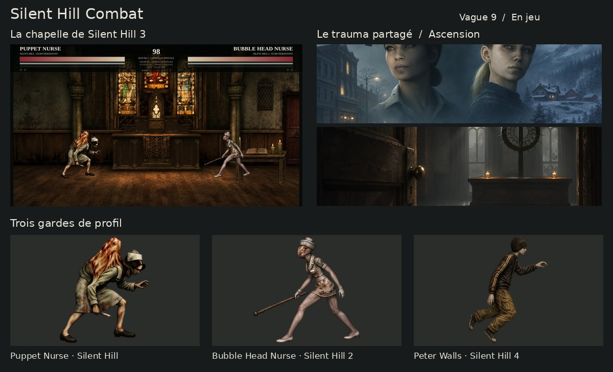

# Silent Hill Combat — la chapelle, les deux infirmières et Peter Walls

La chapelle initiale de *Silent Hill 3* accueille le duel entre deux infirmières des premiers épisodes. La Puppet Nurse d’Alchemilla combat de profil, les genoux fléchis sous son parasite dorsal. La Bubble Head Nurse de Brookhaven tient son tuyau abaissé, une jambe en avant. Chacune conserve son portrait pour la sélection et reçoit un PNG propre à sa garde. Peter Walls, victime 12 de *Silent Hill 4*, reçoit également une garde de profil.

## Dans la chapelle

L’autel et les trois vitraux occupent le fond. La table aux cierges et au livre ouvert constitue le premier plan transparent. Quand les combattants traversent l’arène, le premier plan se déplace de 48,6 pixels dans une fenêtre de 1 280 × 720. Cette pièce est aussi le troisième lieu de la chronique de Heather, *Naître deux fois*. Le guide et les captures de l’édition de 2003 servent de références pour la reconstitution latérale. [Capture du duel et mouvement de la caméra](wave9-stages/README.md)

## Dans la chronique d’Ascension

L’ouverture du *Trauma partagé* met en regard Rachel et Astrid. Le dénouement montre la porte entrouverte, les deux bougies et le symbole de la Fondation. Le parcours de vérification a opposé Snarler à Wanderer, Fighter puis The Immolator. Le résultat affiche trois victoires et conserve The Collector en dossier. Chromium a également vérifié le retour depuis le bilan sur mobile et décodé hors ligne les seize illustrations enregistrées. [Sources et vérification du parcours](wave9-story/README.md)

## Couverture cumulée

Les vagues 8 et 9 totalisent 33 nouveaux fichiers visuels du jeu, soit 15 visuels de personnages, 8 calques dans quatre arènes et 10 illustrations pour cinq chroniques. Le registre compte 191 portraits de sélection et 90 profils avec une vue latérale distincte. Il reste 39 profils sans portrait, 50 sans sprite de combat et 90 dont la vue de combat ancienne attend une vérification. Les dossiers figurent dans ces nombres. Onze des 123 arènes disposent d’un décor bitmap pour la pièce active. Huit des quinze chroniques possèdent leur paire d’illustrations.

La recherche d’un premier portrait pour la manifestation du matelas de *Return to Silent Hill* a permis de reconnaître le décor et certains fragments. Son contour complet reste indéterminé, et elle demeure dans l’inventaire des manquants. Les trois poses livrées sont des reconstitutions statiques dont la fidélité exacte reste à vérifier. [Recherche sur le film](wave9-references/film-mattress.json) · [Registre et manquants](sprite-status-wave9-2026-11-18.json)
