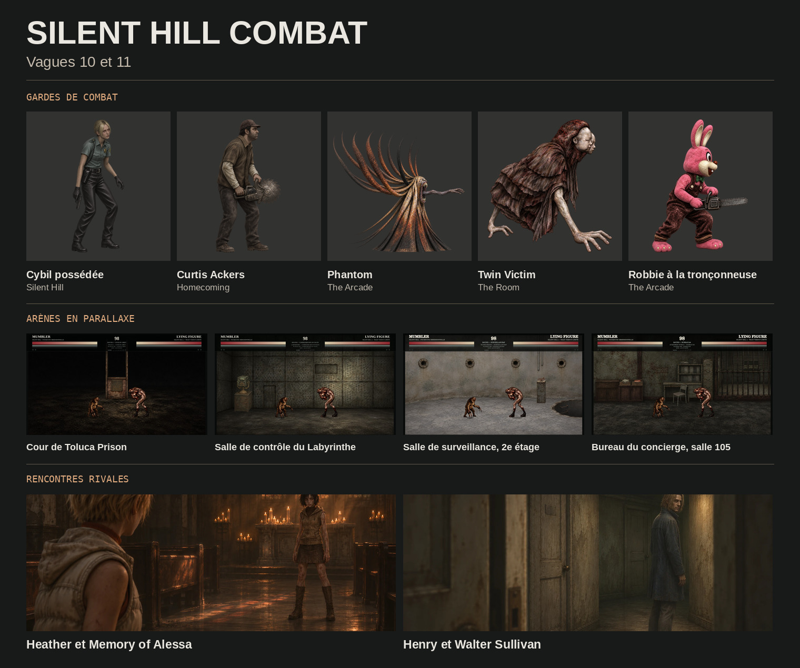

# Silent Hill Combat — vagues 10 et 11

Les deux vagues ajoutent 38 fichiers utilisés par le jeu. La version précédente, à la fin de la vague 9, correspond au commit `f82737a710d3b79ff0d5605fedaa543d61647dfc`. Ses 359 fichiers sous `assets/` correspondent octet pour octet à l’archive du jeu des vagues 8 et 9. Les 22 sprites du premier rattrapage ont également été rapprochés de leur registre d’origine.

Les deux discussions précédentes et leur reprise comptent 41 dessins sources distincts. Trois anciennes compositions restent consultables dans le dossier des variantes, avec leurs empreintes et leurs remplaçantes en jeu. [Variantes de Midwich, Hinako et Phantom](variantes-vagues-10-11/README.md)

## Personnages

| Personnage | Origine | Fichiers ajoutés | Où les voir |
| --- | --- | --- | --- |
| Cybil possédée | Silent Hill | Sélection et garde | Sélection et duel |
| Curtis Ackers | Homecoming | Sélection et garde | Sélection et duel |
| Phantom | The Arcade | Sélection et garde | Sélection et duel, en boss stationnaire |
| Closer de l’église et Numb Body moyen | Silent Hill 3 | Une garde chacun | Duel |
| Wall Man et Man with the Coat | The Room | Une garde chacun | Duel |
| Joseph Schreiber, victime 15 | The Room | Une vue latérale | Atelier, dossier non combattant |
| Patient et Twin Victim | The Room | Une garde chacun | Duel |
| Robbie à la tronçonneuse | The Arcade | Une garde | Duel |

Un fichier contient un seul personnage et une seule pose. L’angle de combat et l’image de sélection ont des entrées distinctes. Le boss Phantom conserve son rôle stationnaire. Les fichiers de sélection et de pose sont des reconstitutions statiques aux dimensions natives, avec canal alpha. Le registre conserve les références et les points qui demandent une comparaison avec le jeu d’origine. [Imports de la vague 10](sprite-wave10-imports-2026-11-18.json) · [Imports de la vague 11](sprite-wave11-imports-2026-11-18.json)

## Arènes

La cour de Toluca Prison et la salle de contrôle du Labyrinthe reprennent deux lieux de *Silent Hill 2*. La salle de surveillance centrale du deuxième étage de Water Prison et le bureau 105 du concierge de South Ashfield reprennent deux lieux de *The Room*. Chacun des quatre décors possède un fond et un accessoire dont le déplacement suit la caméra. [Toluca Prison et Labyrinthe](wave10-stages/README.md) · [Water Prison et bureau 105](wave11-stages/README.md)

## Chroniques

Sept paires d’illustrations complètent les 15 ouvertures et les 15 fins du catalogue. Une première rencontre rivale montre Heather face à Memory of Alessa et une seconde Henry face à Walter Sullivan. Le jeu choisit l’interlude selon la chronique, le chapitre et l’adversaire. [Illustrations et contrôles des chapitres](wave10-story/README.md)

## Travail restant

Le catalogue compte 194 portraits pour 230 profils. Il reste 36 portraits à produire, 46 profils sans image de combat et 83 vues de combat anciennes à examiner. Les dossiers non combattants sont compris dans ces catégories. Le catalogue comporte 101 vues latérales distinctes et une animation enregistrée. Les nouvelles gardes sont statiques. La comparaison requise pour certifier leur fidélité exacte reste à faire. Quinze des 123 arènes disposent d’un décor bitmap actif. [Identifiants et liste des manquants](sprite-status-wave11-2026-11-18.json)

## Vérifications en jeu

Dans le moteur de combat avec Canvas 2D Skia, les dix combattants ont chacun occupé la gauche et la droite de l’écran. Les cinq paires ont passé 70 contrôles. Joseph a été vérifié séparément dans les modules Atelier et Versus. [Captures et mesures natives](qa-sprite-wave11/native/) · [Sélection, profil et rôle de Joseph](qa-sprite-wave11/native/joseph-ui.json)

Chromium a affiché le duel entre Cybil et Curtis à Toluca Prison dans les deux ordres et a dessiné les PNG attendus. Le processus de rendu local s’est arrêté au passage à la paire suivante. [Relevé des deux duels Chromium](qa-sprite-wave11/report.json) · [Contrôle des deux chapitres rivaux](wave10-story/qa-rivals/report.json)
