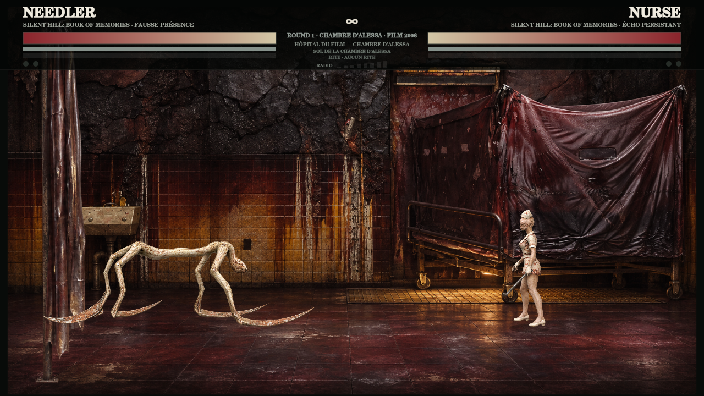
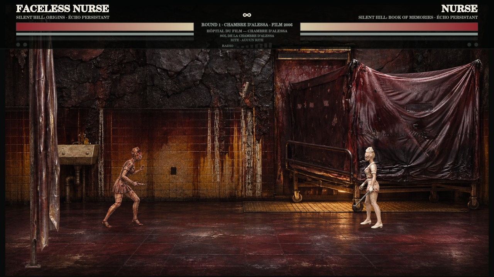
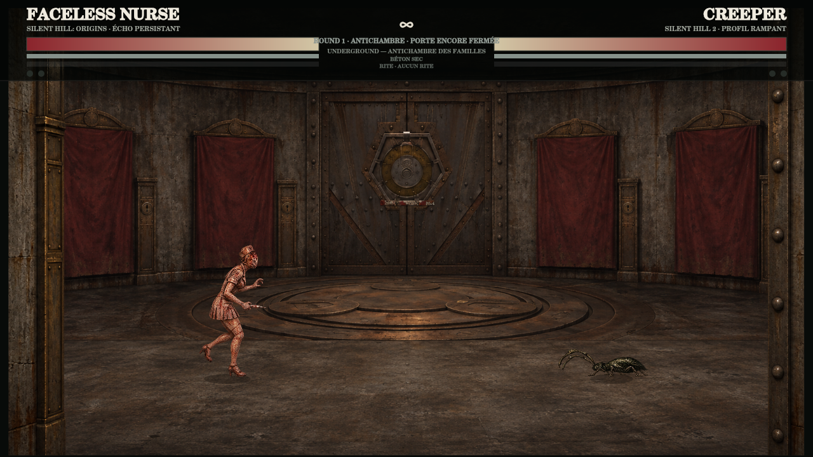

# Vague 17 — sprites latéraux, marche Origins et deux arènes

Livraison du 19 novembre 2026 pour la PR #6, à partir de `96cbd9c49233230e8ddaed08f6f6063734aef96e`. Cette vague ajoute **10 PNG actifs** et conserve **3 variantes Needler non retenues**. Chaque fichier de combattant contient un seul sujet dans une seule pose. Les portraits antérieurs restent séparés et inchangés.

## Images et comportement livrés

| Sujet | Nouvelle production | Utilisation conservée |
|---|---|---|
| Doll — Downpour | 1 vue latérale entière, 1254 × 1254 | Référence d’obstacle environnemental ; aucun duel ni locomotion ajoutés |
| Raw Shock Diseased — Shattered Memories | 1 vue latérale entière, 1254 × 1254 | Rencontre scénarisée de poursuite ; aucun duel autonome ajouté |
| Needler — Book of Memories | 1 vue latérale entière, 1774 × 887 | Combattant ; quatre membres-lames, portrait séparé |
| Nurse — Book of Memories | 1 vue latérale entière, 1254 × 1254 | Combattante ; variante à tête chair lisse, Steel Pipe entier |
| Faceless Nurse — Origins | 2 poses de déplacement, 1108 × 1420 et 1199 × 1312 | Nouveau clip de marche, idle et garde existants conservés |
| Underground — Homecoming | Fond + montants proches transparents, chacun 1672 × 941 | Antichambre des familles fondatrices, porte fermée et quatre tablettes couvertes |
| Chambre d’Alessa — film 2006 | Fond + premier plan transparent, chacun 1672 × 941 | Chambre d’isolement, tente opaque et sol dégagé |

### Marche Origins

Le clip `walk` parcourt **`[0, 2, 3, 2]`**, à **7 ticks par étape**, en boucle. Il emploie trois dessins distincts : l’idle existant à l’index 0, une nouvelle pose de passage à l’index 2 et un nouveau contact à l’index 3. La garde reste à l’index 1. Les 28 ticks de la séquence sont un réglage du prototype, pas une mesure de l’animation commerciale.

C’est un premier cycle court ; la pose de passage est réutilisée au retour. Aucun moveset complet, saut dessiné, attaque animée ou présentation animée supplémentaire n’est revendiqué. Les fichiers natifs sont conservés sans redimensionnement ni nettoyage externe. Les ancrages servent uniquement à leur placement par le moteur.

### Décors

Les deux scènes disposent d’un fond fixe et d’un premier plan à parallaxe horizontale `0.012`. Les quatre images restent statiques. Les références documentent le lieu et ses éléments ; le cadrage large, les distances et la piste de combat sont reconstruits pour le versus.

Dans la chambre d’Alessa, les effets existants `gansAlessaTentCloth` et `alessaRoomRoundRest` sont raccordés au plastique peint. Le nouveau helper est limité à cette scène et à l’empreinte exacte du fond : de faibles reflets de plis remplacent le dessin procédural d’une tente complète. Il respecte l’horloge de simulation, la réduction des mouvements et les animations désactivées. La chambre n’est pas présentée comme Brookhaven ou comme le couloir des Dark Nurses.

## Raccordement et conservation

Les imports passent par `import-sprite.py` et `apply-sprite-clip.py`. Registre, manifeste généré, couverture et cache hors ligne sont actualisés. L’intégralité des métadonnées des **204 portraits existants** a été comparée à la base : aucune modification.

Les trois premiers essais Needler sont conservés sous [variants/](variants/) avec leurs motifs : cinq membres sur v1 ; torse encore oblique sur v2 et v3. Ils ne sont ni actifs, ni comptés comme nouvelles vues latérales.

Le changement de sélection a aussi été corrigé : « Signal aléatoire » ou le choix d’une autre arène revient à la sélection avant de remplacer un combat vivant. Cela libère ses images avant le prochain préchargement et évite une union inutile de deux combats. La simple consultation de la galerie et le choix de l’arène courante conservent le combat. En Récit et Tournoi, l’arène imposée par le parcours reste inchangée et la galerie ne termine pas la rencontre. Le parcours sauvegardé et la récupération après un échec d’image restent conservés.

## Évolution mesurée

| Indicateur | Avant | Après |
|---|---:|---:|
| Profils du catalogue | 230 | 230 |
| Portraits disponibles | 204 | 204 |
| Vues latérales candidates | 123 | 127 |
| Anciennes vues de combat à revoir | 70 | 66 |
| Images de combat manquantes | 37 | 37 |
| Portrait et combat distincts | 124 | 128 |
| Arènes avec images intégrées | 24 / 123 | 26 / 123 |
| Clips animés distincts | 2 | 3 |
| Présentations animées | 0 | 0 |
| Fidélité 1:1 certifiée | 0 | 0 |

Les quatre nouveaux profils remplacent des vues anciennes déjà présentes ; ils ne réduisent donc pas les 37 images de combat encore absentes. Les 26 portraits manquants restent également ouverts.

## Vérifications

- **1 281 tests JavaScript réussis**, dont cinq contrôles du raccord de la tente : scène et hash exacts, projection du fond, absence d’une seconde silhouette, gel temporel et repos de manche.
- **115 tests Python réussis**, pour l’import, les images, les calibrations et le classeur.
- **80 contrôles natifs réussis**, sur le vrai `FightEngine` rendu par Canvas natif : quatre duels dans les deux ordres et six portraits. Les captures finales ont été inspectées ; les sujets, leurs armes et leurs appuis restent visibles.
- **118 contrôles natifs de marche réussis**, avec 18 captures : deux cycles complets dans chaque sens, trois PNG distincts observés, sept ticks exacts par étape, garde, quatre retours idle et croisement par saut normal. Aucun état d’acteur injecté. Voir [la preuve de marche](qa-native-walk/report.json).
- **14 365 / 14 365 duels auparavant illustrés toujours admis** au lancement, avec les budgets de 64 Mio par cache conservés. Les tailles sont calculées sur les pixels décodés et dédupliqués, pas les PNG compressés. Voir [l’audit mémoire](memory-audit.md).
- **13 PNG de production vérifiés** par dimensions, octets et SHA-256 ; les quatre idles passent les lecteurs des campagnes historiques sans assouplir leurs contrats.
- Le lancement Chromium local a été bloqué avant toute page par `socket() failed: Operation not permitted`. Le [constat local](local-browser-probe.json) ne prétend pas valider le navigateur. Le scénario `qa:wave17` est intégré en tête de la campagne HTTP de la PR ; son résultat est à consulter dans les checks du commit publié.

La QA HTTP observe les PNG effectivement dessinés, les commandes de marche et de garde, le saut normal qui change de côté, les portraits de sélection, les rôles non combattants, la parallaxe et la libération des anciens actifs lors d’un nouveau choix. Elle n’injecte ni pose, ni position, ni orientation, ni horloge dans les acteurs.

## Captures du moteur

## Réserves artistiques et traçabilité

La silhouette Needler est latérale mais son torse reste plus étiré que la référence candidate. Les quatre nouveaux profils présentent des franges claires ou colorées visibles en plein format ; celles de Needler et Nurse sont discrètes dans les captures de combat examinées. Les marges réelles des quatre images vont de 3,6 % à 9,1 % au minimum, et n’atteignent pas partout les 12 % demandés. L’audit technique constate l’intégrité des contours sans certifier leur perfection artistique.

Les poses, angles cachés, proportions, matériaux et timings restent des **candidats non certifiés**. Les fichiers ne sont pas annoncés comme de l’UHD native. La lecture latérale par miroir du moteur ne constitue pas une deuxième vue sourcée.

- [Receipt des imports et des images conservées](../sprite-wave17-imports-2026-11-19.json)
- [Génération des quatre profils et variantes](fighters-generation.json)
- [Prompts et provenance des deux poses Origins](nurse-walk-provenance.json)
- [Provenance Underground](underground-provenance.json)
- [Provenance chambre d’Alessa](alessa-room-provenance.json)
- [Journal des tests JavaScript et du build](npm-test.txt)
- [Journal des tests Python](python-tests.txt)
- [Rapport de QA native](qa-native/report.json)
- [Historique de la description de PR avant cette vague](../PR_HISTORY_THROUGH_WAVE16.md)
