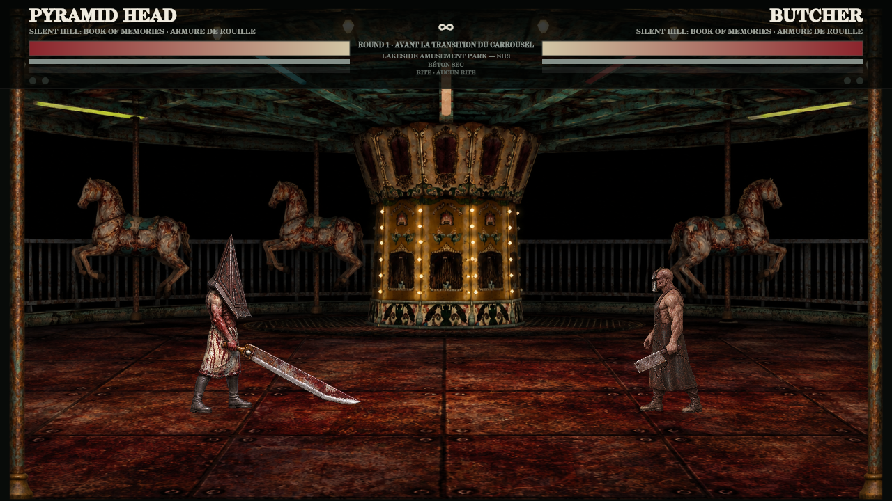
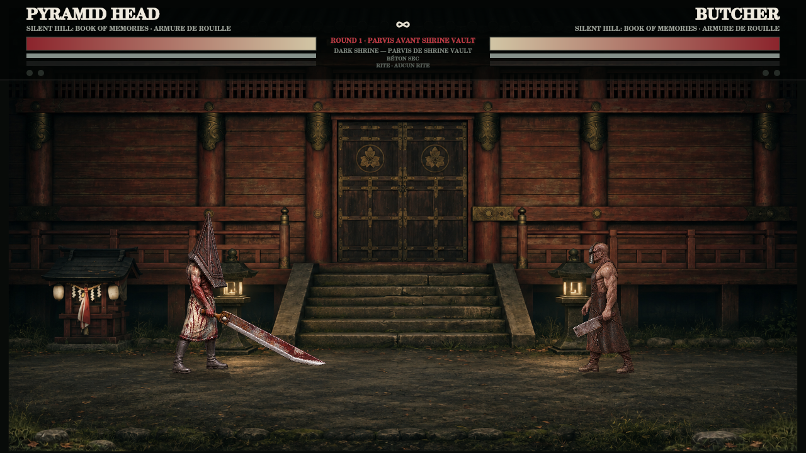
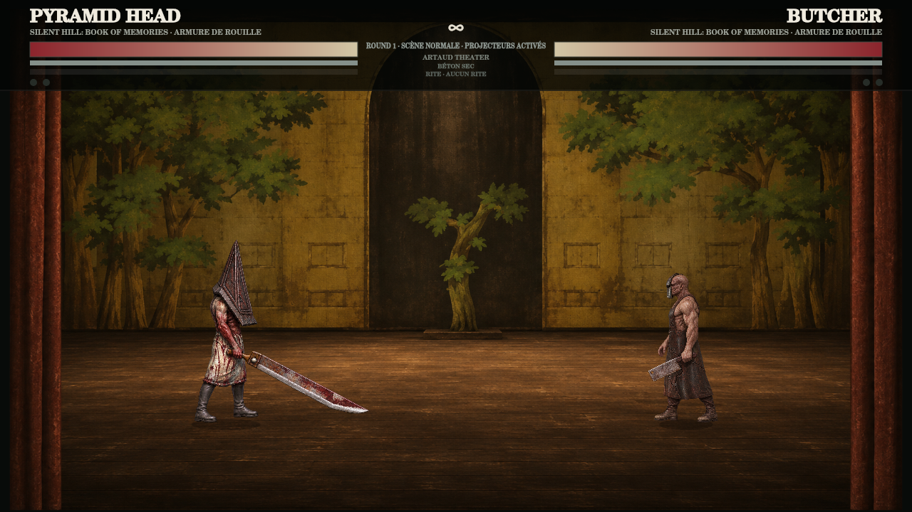

# Vague 20 — passe consacrée aux stages manquants

**Onze nouveaux stages intégrés, 22 PNG : la couverture passe de 32 à 43 arènes
bitmap sur 123.** Il reste 80 stages sans bitmap : 65 non bloqués dans le
catalogue et 15 bloqués par leur fiche de référence. La sélection documentaire
ne clôt pas automatiquement les actions de fidélité artistique.

La base publiée est `2db0c78284f681d641d439c62e1bd4487838677e`, dans la
[PR #6](https://github.com/darknigthmare/silent-hill-halo-of-flesh/pull/6).
Cette passe du 19 novembre 2026 porte exclusivement sur les décors manquants.
Le [bilan structuré](delivery.json), l'[audit final](final-audit.json) et les
[décisions de sélection](selection-decisions.json) donnent les chiffres exacts.

## Lieux livrés

Chaque ligne fournit deux fichiers indépendants : un fond opaque et un premier
plan avec transparence réelle. Le fond est fixe ; le plan proche utilise la
parallaxe existante du moteur. Les scènes sont sélectionnées par les identifiants
et politiques de référence déjà en place.

| Stage | Œuvre | Pièce et état représentés |
| --- | --- | --- |
| `sewers` | Silent Hill 3 | Passerelle des égouts après le sèche-cheveux ; eau en dessous, sans créature vivante ni effet électrique ajouté. |
| `lakeside_sh3` | Silent Hill 3 | Happy Carousel avant la transition ; chevaux et hub à l'arrière du plateau de duel. |
| `nightmare_hospital_sh3` | Silent Hill 3 | Réserve au miroir de Brookhaven Otherworld ; pièce distincte du bassin de Leonard. |
| `dark_shrine` | Silent Hill f | Parvis fermé de Shrine Vault avec son Hokora. |
| `school_shf` | Silent Hill f | Bureau du personnel et armoire à clés. |
| `hinako_home` | Silent Hill f | Corridor d'entrée et de sortie de Residence I. |
| `corrupted_ebisugaoka` | Silent Hill f | Parvis Shimizu dans Ebisugaoka Part 5 : façade, pots, linge, bicyclette et flore rouge. |
| `hospital_world` | Silent Hill 4 | Couloir du deuxième étage de l'hôpital, chambres fermées. |
| `artaud_theater` | Silent Hill: Origins | Scène normale éclairée avec le décor peint de forêt installé. |
| `devils_pit` | Silent Hill: Downpour | Caverne des roues à eau et de l'ascenseur, vue depuis la passerelle sèche d'Upper Caverns. |
| `overlook` | Silent Hill: Downpour | Block A, Cells A2, avant la vision inondée et sa barrière. |

Les quatre stages de Silent Hill f conservent un coefficient de parallaxe de
`0.006` ; les sept autres utilisent `0.012`. Les deux couches des quatre stages
du groupe C — Hospital World, Artaud Theater, Devil's Pit et Overlook — sont
ajustées avec `stretch` pour conserver tout le cadrage. Les sept autres
compositions utilisent `cover`. Aucun changement au moteur de rendu n'est requis.

Les 22 PNG représentent **29 422 837 octets**. Leurs dimensions natives sont
1672 × 941 ou 1671 × 941 pixels. Le fond des égouts et le premier plan d'Hospital
World mesurent 1671 pixels de large ; cette différence native d'un pixel reste
explicitement documentée. Aucun fichier n'a été agrandi, détouré ou retouché
après génération. Les empreintes des originaux et des fichiers intégrés
correspondent dans les [reçus A](integration-a.json) et [B/C](integration-b-c.json).

## Références, génération et reports

Les dossiers [A](group-a/delivery.json), [B](group-b/delivery.json) et
[C](group-c/delivery.json) conservent les prompts, références, empreintes des
sources, dimensions, alpha et notes de cadrage. Pour C, les [prompts](group-c/prompts.json),
la [provenance](group-c/generation.json), le [relevé raster](group-c/raster-audit.json)
et les [sources](group-c/references/source-downloads.json) sont séparés.
Les pages complètes des guides et les PDF source ne sont pas recopiés dans le dépôt.

Douze lieux étaient envisagés. La passe livrée s'arrête à onze lieux documentés :

- **Nightmare Mall** : les vues inspectées ne montrent pas suffisamment
  l'architecture complète de l'arène aux six tunnels. Aucun décor complet n'a été
  produit à partir du seul gros plan du boss.
- **Toit de Daisy Villa** : le remplacement envisagé présente la même limite.
  Les références retrouvées montrent surtout Missionary isolé, sans vue du toit
  assez lisible. Aucun asset n'a été généré pour ce lieu. Les
  [sources A](group-a/guide-sources.json) et la [clôture A](group-a/qa-summary.md)
  conservent la décision.
- **Salle à manger Shimizu** : le contrat local désigne Residence I, tandis que
  le [guide consulté](https://www.silenthillmemories.net/shf/walkthrough_11_shimizu_residence_en.htm)
  place le Yellowed Calendar et sa salle dans Residence II. La politique locale
  reste intacte. Le parvis documenté de Part 5 remplace cette cible dans le lot ;
  la salle à manger demeure manquante.

Il s'agit de **reconstructions candidates adaptées au duel latéral**. Les marges
et le cadrage ne constituent pas une transcription certifiée pixel pour pixel.
Deux images fixes avec parallaxe ne comptent pas comme un nouveau clip animé.
Aucune certification 1:1 ou UHD n'est ajoutée.

## Vérifications exécutées

| Vérification | Résultat et portée |
| --- | --- |
| Import des assets | 22 fichiers PNG, métadonnées, empreintes et sélection exacte validés. Pixels et alpha des sorties conservés. |
| Tests ciblés existants | **137 réussis, 0 échec**, stages et rendu Canvas ; [journal](stage-tests.txt). |
| Vérification du build source | Réussie : syntaxe de 45 JS, liens de 10 HTML, catalogue et contrats ; [journal](build-verification.txt). `--verify-only` ne produit pas de `dist`. |
| Moteur réel avec Canvas natif | **356 contrôles réussis**, onze duels et onze captures ; [rapport](qa-native/report.json). |
| Revue visuelle des captures | Onze compositions inspectées, aucun défaut bloquant de cadrage, d'alpha, d'appui ou de HUD ; rapports [A](group-a/native-visual-review.json), [B](group-b/native-visual-review.json), [C](group-c/native-visual-review.json). |
| Intégrité du périmètre | Quinze fichiers protégés identiques à la base ; anciennes compositions et variantes inchangées. |
| Mémoire des stages | 43 sélections et 946 paires actives admises ; 45 pièces stockées et 1 035 paires avec variantes admises, sans augmentation du budget. |

Le [harness](../../../scripts/qa-stage-pass20-native.mjs) utilise `FightEngine`,
son rendu Canvas et les callbacks réellement enregistrés par `InputState`.
Il attend l'introduction normale, dessine les deux couches exactes, applique
le déplacement dans chaque direction puis le retour à l'idle. Les deltas de
parallaxe sont comparés au mouvement observé des acteurs. Aucune position,
phase, santé, orientation ou horloge d'acteur n'est affectée par le harness.
Les fichiers PNG et sources sont recontrôlés après exécution.

Les deux combattants BoM visibles dans les captures servent uniquement de
témoins existants. Le test désactive dangers et terrain : le libellé neutre
« BÉTON SEC » présent sur certaines captures vient de cette configuration.
Il ne décrit pas la matière du sol source et ne révèle pas un défaut des PNG.

Ces contrôles natifs n'exercent pas Chromium, le DOM, HTTP ou les service workers.
Ils ne vérifient pas de nouvelle attaque, fatalité, animation de lieu, timing
source ou fidélité artistique. Les deux workflows GitHub Actions étaient
réussis sur la **base précédente** ; leur résultat sur le nouveau commit doit
être lu séparément après publication.

### Captures du moteur







Les huit autres captures figurent dans [qa-native](qa-native/).

## Périmètre conservé et suite de l'inventaire

Le registre compte désormais **45 compositions de pièces stockées**, dont 43
sélectionnées actuellement. Elles référencent **84 PNG**, dont 82 actifs et deux
historiques inactifs. Ces chiffres distinguent les stages, les pièces et les
fichiers ; ils ne doivent pas être additionnés comme s'il s'agissait de lieux
supplémentaires.

Le cache des décors conserve son budget de **64 Mio**. Le plus grand ensemble
d'une arène occupe 12 587 560 octets décodés ; la plus grande union de deux
arènes, 25 175 120 octets. Les empreintes des implémentations de cache sont
identiques à la base. Ce calcul de capacité ne constitue pas une mesure de
performances navigateur.

Les portraits, sprites de combat, movesets, règles et fiches de stage restent
inchangés. Le classeur de production est identique octet pour octet à la vague 19 :
son dernier relevé factuel de décors reste donc celui des 32 arènes. Les
43 arènes courantes et la liste précise des **80 stages encore manquants**
sont consignées dans [final-audit.json](final-audit.json), sans réécrire les
annotations du classeur dans cette passe.

Pour reproduire les vérifications ciblées :

```sh
node --test --test-concurrency=2 tests/stage-*.test.mjs tests/render-smoke.test.mjs
node scripts/build.mjs --verify-only
node docs/production/vague20/audit-final.mjs
node scripts/qa-stage-pass20-native.mjs --stages=sewers,lakeside_sh3,nightmare_hospital_sh3,dark_shrine,school_shf,hinako_home,corrupted_ebisugaoka,hospital_world,artaud_theater,devils_pit,overlook --out=/tmp/halo-stage20-new-evidence
```

Le dernier répertoire doit être neuf. Canvas natif requiert `@napi-rs/canvas`
et `sharp`, disponibles dans l'environnement de vérification utilisé. L'audit
enregistre seulement son rapport ; le harness conserve ses nouvelles captures
sans remplacer les preuves déjà livrées.
